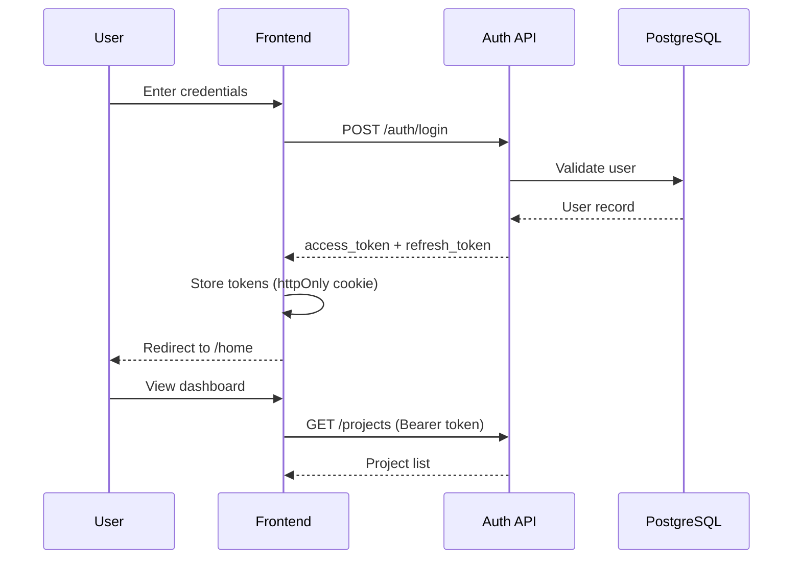
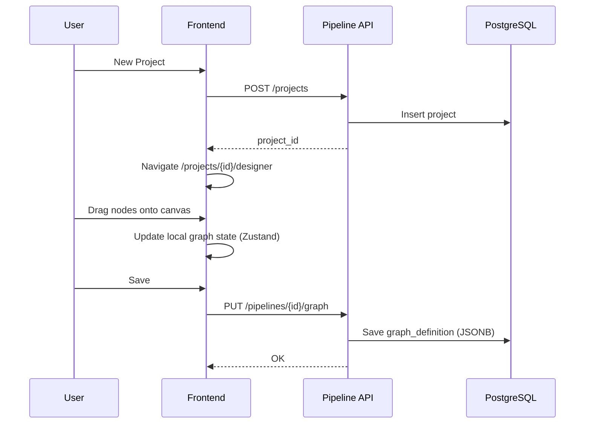
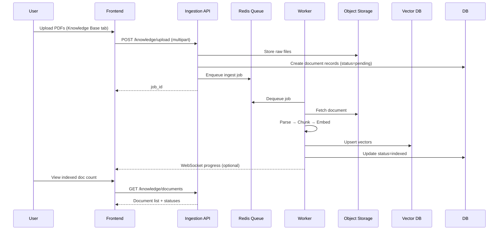
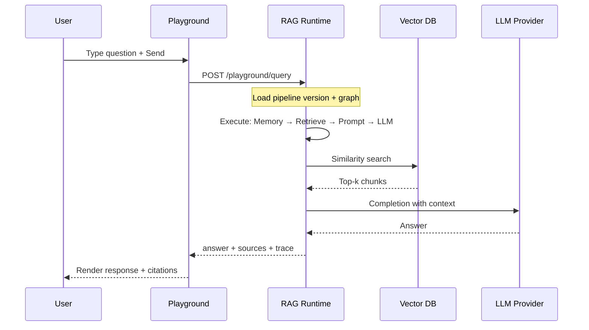
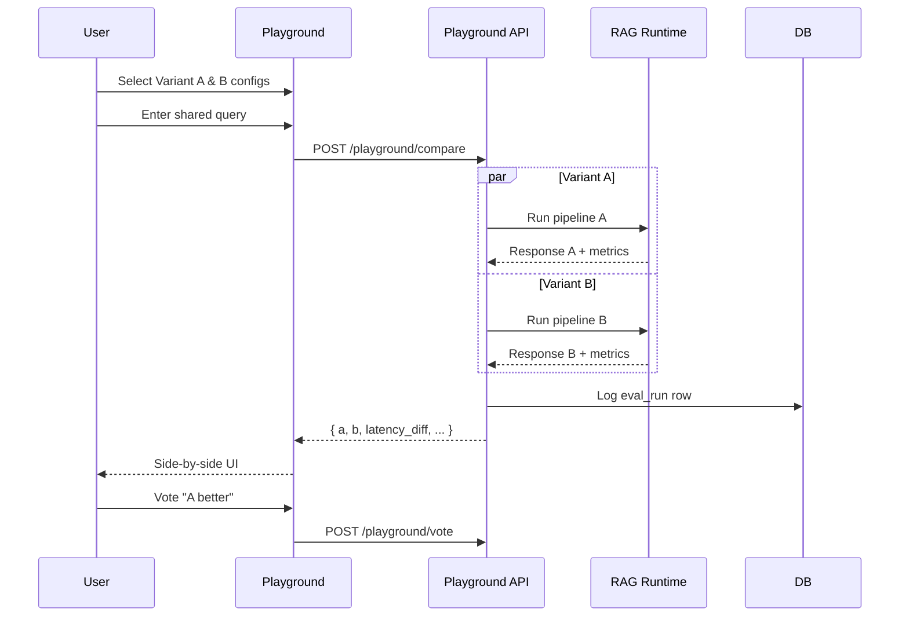
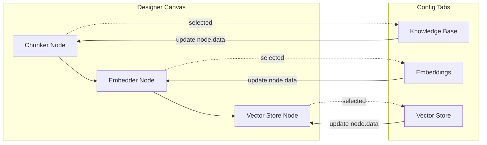
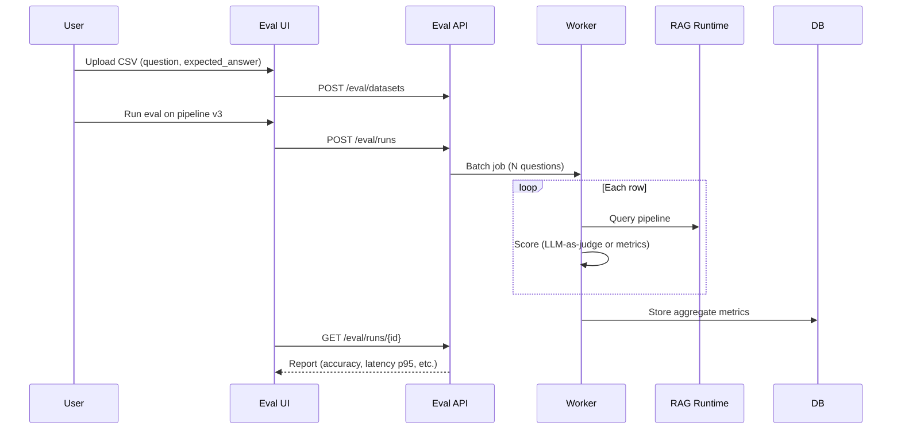

# RAG Platform — Workflows & Sequence Diagrams

## 1. Login → Home

---

## 2. Create RAG Project & Open Designer

---

## 3. Knowledge Base Ingestion

---

## 4. Playground Query (Single Pipeline)

---

## 5. A/B Playground Compare

---

## 6. Designer ↔ Config Tab Sync

**Rule**: Each node type maps to a tab panel. `node.data.config` is the single source of truth; tabs read/write that object.

---

## 7. Evaluation Batch Run

---

## 8. Page Routes (Frontend)

| Route | Page | Auth |
|-------|------|------|
| `/login` | Login | Public |
| `/register` | Register | Public |
| `/home` | Dashboard | Protected |
| `/projects` | Project list | Protected |
| `/projects/[id]` | Project overview | Protected |
| `/projects/[id]/designer` | Visual RAG designer | Protected |
| `/projects/[id]/knowledge` | Knowledge base tab | Protected |
| `/projects/[id]/memory` | Memory config | Protected |
| `/projects/[id]/retrieval` | Retrieval config | Protected |
| `/projects/[id]/generation` | LLM & prompts | Protected |
| `/projects/[id]/playground` | Playground + A/B | Protected |
| `/projects/[id]/evaluation` | Batch eval | Protected |
| `/settings` | User & org settings | Protected |

Designer can be the default tab with sub-routes or a tab layout wrapping all RAG steps.
